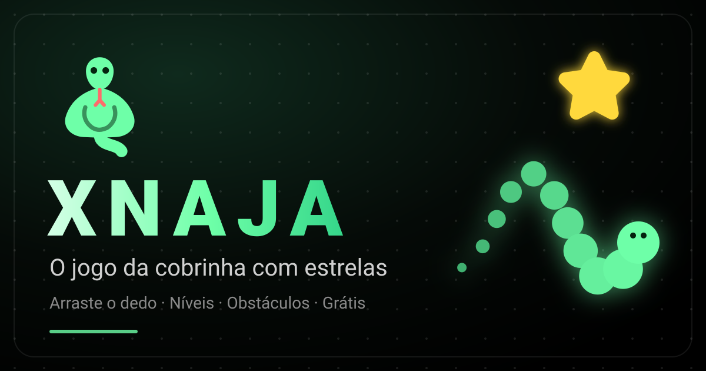

<h1>
  
  XNAJA
</h1>
<h3>
  
  O clássico jogo da cobrinha
</h3>

*Jogo online, gratuito e otimizado para Mobile e Desktop*

---

  

---

<h2>
  
  Visão Geral
</h2>

O **XNAJA** é um jogo da cobrinha (Snake) moderno, online e gratuito. Desenvolvido com tecnologias web nativas (HTML5, CSS3 e JavaScript puro), ele oferece uma experiência fluida e responsiva tanto em dispositivos móveis quanto em desktops.

O objetivo é simples: guie a cobrinha, coma o máximo de estrelas que puder e evite bater no próprio corpo, nos obstáculos ou nas bordas (se configuradas como sólidas).

<h3>
  
  Por que jogar?
</h3>

-  **Zero instalação** - Jogue direto no navegador
-  **PWA** - Instale no celular e jogue offline
-  **Temas Dinâmicos** - O jogo muda de cor conforme você avança
-  **Inteligente** - Sistema de níveis, obstáculos e vidas extras
-  **Performático** - Renderização otimizada via Canvas API

---

  
  <b>Stack de Tecnologias (Clique para expandir)</b>

 

---

<h2>
  
  Como Jogar
</h2>

Você pode jogar diretamente no navegador (online) ou rodar o projeto localmente.

<h3>
  
  Jogar Online
</h3>

Acesse: [https://ravenastar.com/xnaja/](https://ravenastar.com/xnaja/), [https://xnaja.ravenastar.com/](https://xnaja.ravenastar.com/) ou [https://xnaja.pages.dev/](https://xnaja.pages.dev/)

---

<h2>
  
  Controles
</h2>

| Ação | Teclado | Mobile |
| :--- | :--- | :--- |
| **Mover** | <kbd>↑</kbd> <kbd>↓</kbd> <kbd>←</kbd> <kbd>→</kbd> ou <kbd>W</kbd> <kbd>A</kbd> <kbd>S</kbd> <kbd>D</kbd> | Arraste o dedo ou use o D-pad |
| **Pausar** | <kbd>Espaço</kbd>, <kbd>P</kbd> ou <kbd>Esc</kbd> | Toque no botão "Pausar" |
| **Som** | <kbd>M</kbd> | Toque no ícone de volume |
| **Jogar** | <kbd>Enter</kbd> | Toque em "Jogar" |

---

<h2>
  
  Recursos Principais
</h2>

-  **Controles Adaptáveis:** Sistema de arrasto suave para mobile e teclado preciso para desktop.
-  **Temas Dinâmicos:** A paleta de cores do jogo inteiro muda conforme você sobe de nível.
-  **Sistema de Níveis:** A cada 5 estrelas, você sobe de nível e a velocidade da cobra aumenta.
-  **Obstáculos:** Desafie-se com blocos no tabuleiro (configurável: Nenhum, Poucos ou Muitos).
-  **Vidas Extras:** A partir do nível 4, corações aparecem. Ao bater, você entra no "Modo Fantasma" e atravessa o próprio corpo por alguns passos.
-  **Modo Prisma:** Desbloqueie efeitos visuais holográficos ao alcançar o nível 10.
-  **PWA:** Jogue offline e instale no seu celular ou desktop.
-  **Áudio Imersivo:** Efeitos sonoros gerados proceduralmente via Web Audio API.

---

<h2>
  
  Licença
</h2>

Este projeto está sob a licença MIT. Veja o arquivo [LICENSE](LICENSE) para detalhes.

---

<h2>
  Feito com 
   
  por <a href="https://linktr.ee/ravenastar">RavenaStar</a>
</h2>

<a href="#-xnaja">
   
  Voltar ao topo
</a>

